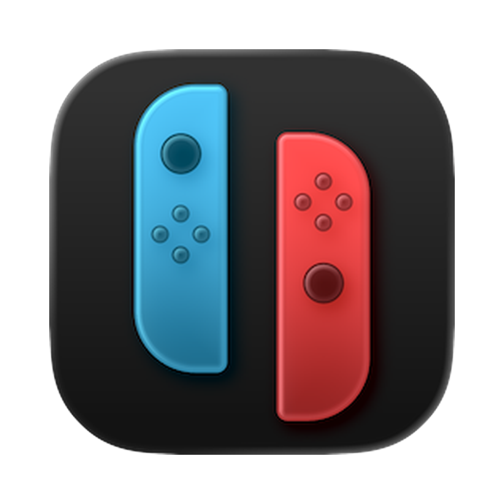

# Astris Discord Rich Presence



App macOS de barre de menus qui ajoute le Discord Rich Presence à [Astris](https://github.com/V380-Ori/Astris.Binaries), l'émulateur Switch basé sur Ryujinx pour Mac Apple silicon.

**En jeu** : nom du jeu, jaquette (badge Astris + version + mode TV/portable), « Sur Astris · 12 h jouées » (+ « Multijoueur local » si actif dans Astris), chrono de session, boutons « Voir sur l'eShop » et « Astris ». Textes et boutons personnalisables, globalement ou par jeu.
**En pause** : sans clavier, souris ni manette pendant 15 min (réglable), « En pause · Sur Astris », sans chrono.
**Dans le menu d'Astris** : « Dans le menu » avec le logo Astris.

📖 **[Toutes les fonctionnalités](docs/FONCTIONNALITES.md)**

## Installation

1. Télécharger `AstrisRPC.dmg` depuis les [Releases](https://github.com/seishiiinsan/astris-discord-rich-presence/releases).
2. L'ouvrir et glisser l'app dans `Applications`.
3. Releases notarisées (secrets de signature configurés, voir Release) : rien à faire. Sinon, au 1er lancement, retirer la quarantaine :
   ```bash
   xattr -dr com.apple.quarantine /Applications/AstrisRPC.app
   ```
4. Menu 🎮 → Réglages… → « Ouvrir à la connexion » et « Dossier des jeux ».

Prérequis : macOS 13+, Discord desktop lancé.

## Menu

- Icône : manette pleine en jeu, vide sinon, grisée si Astris fermé ou désactivé, ⚠︎ si Discord fermé pendant qu'Astris tourne (infobulle = état)
- État : jeu en cours (+ temps déjà joué, ou « En pause »), Discord connecté / ouvert — ou « Discord fermé — Ouvrir Discord », cliquable ; « Discord a refusé l'affichage » + raison si Discord rejette la presence
- Jeux récents : 5 derniers jeux (avec jaquette), un clic les ouvre dans Astris
- Favoris : jeux étoilés dans Réglages → Jeux
- Afficher sur Discord (⌃⌥⌘D partout dans macOS)
- Masquer ce jeu sur Discord (⌃⌥⌘H), en jeu seulement
- Mode streamer
- Réglages… (⌘,)
- Mettre à jour vers vX (si dispo) / Rechercher les mises à jour… / version
- Copier le diagnostic : état, jeu, TitleID, sources de jaquette, journal récent — à coller dans une issue
- Quitter Astris RPC

## Réglages

- **Général** : afficher sur Discord, ouvrir à la connexion, raccourcis globaux, délai « En pause » (jamais, 5–30 min), langue (Mac / français / anglais), dossier des jeux (repris d'Astris si vide), notifications (Discord déconnecté, mise à jour, bilan du dimanche soir), dépannage (journal dans `~/Library/Logs/AstrisRPC.log`, vider le cache des jaquettes).
- **Discord** : mode streamer (cache temps joué / bouton eShop / jaquettes), lignes 1 et 2 avec variables `{game}`, `{played}`, `{version}`, `{mode}`, `{multi}` (une partie « · » sans valeur est retirée), clé SteamGridDB (+ « Préférer SteamGridDB »), bouton eShop, bouton perso (libellé + https) à la place d'« Astris ».
- **Jeux** : liste des jeux du dossier (jaquette, recherche, ★ favoris). Double-clic ou « Lancer dans Astris » ouvre le jeu. Par jeu : afficher ou masquer sur Discord (liste noire → « En jeu · Sur Astris », sans nom ni jaquette), nom affiché, texte propre au jeu, temps joué masquable, jaquette perso (URL https, ou image glissée/choisie : visible dans l'app seulement), type (jeu de base, mise à jour, DLC) et TitleID. Réglages liés au nom du fichier.
- **Statistiques** : temps joué cette semaine et au total, graphe 7 jours / 4 semaines, par jeu (tri plus joué / plus récent, temps compté par Astris à côté), export CSV. Compté par l'app, pauses exclues. `~/Library/Application Support/AstrisRPC/history.json`.

## Liens `astrisrpc://`

Pour Raccourcis, Raycast, Alfred ou `open` dans le Terminal :

| Lien | Effet |
| --- | --- |
| `astrisrpc://on` / `off` / `toggle` | affichage sur Discord |
| `astrisrpc://hide-game` | masquer / réafficher le jeu en cours |
| `astrisrpc://streamer` (`?on=1` / `?on=0`) | mode streamer |
| `astrisrpc://launch?game=Zelda` | lancer un jeu (récents, favoris, puis dossier des jeux) |
| `astrisrpc://settings` | ouvrir les Réglages |

## Langue

Français si la 1ʳᵉ langue du Mac est le français, anglais sinon (menu, alertes, textes Discord, liens eShop).

## Mises à jour

L'app vérifie les releases GitHub au lancement puis toutes les 6 h. L'alerte affiche les notes de version. En un clic : télécharge le `.zip`, remplace l'app, la relance. Les erreurs de vérification s'affichent en alerte.

## Fonctionnement

- **Astris** : notifications de lancement/fermeture (`NSWorkspace`) ; aucune vérification tant qu'Astris est fermé.
- **Jeu** : fichier ouvert par Astris (`.xci .xcz .nsp .nsz .nro`), via libproc toutes les 3 s, `lsof` en secours au plus toutes les 6 s. Aucune permission macOS requise.
- **TitleID, titre, temps joué** : `~/Library/Application Support/Astris/games/<TitleID>/gui/metadata.json` (réécrit au lancement du jeu), ou `[01…]` dans le nom du fichier.
- **Jaquette** : jaquette perso si https, sinon 1ʳᵉ image valide parmi tinfoil.media 1024 px, 512 px et api.nlib.cc (TitleID puis jeu de base), puis SteamGridDB par nom si une clé est réglée (ou en premier si préféré), sinon logo Astris.
- **Config Astris** (`Config.json`) : `game_dirs` (dossier des jeux), `docked_mode` (mode TV/portable), `multiplayer_mode` (multijoueur local). Favoris d'Astris (`metadata.json` → `favorite`) importés une fois par jeu.
- **Lien eShop** : fiche du jeu via son NSUID (api.nlib.cc), sinon recherche Nintendo.
- **Cache** : jaquettes et liens eShop trouvés gardés 30 jours, absences 3 jours (`~/Library/Caches/AstrisRPC`), images téléchargées une seule fois.
- **Version** : mise à jour choisie dans Astris (`games/<TitleID>/updates.json`) ou nom du fichier (`[v1.2.0]`, `[v196608]` → màj 3).
- **Pause** : dernière entrée clavier/souris (`CGEventSource`) ou manette (`GameController`, en arrière-plan). Aucune permission requise.
- **Raccourcis** : hot keys Carbon, sans permission Accessibilité. Désactivables si une autre app les utilise.
- **Limites Discord** : textes coupés à 128 caractères (libellés de bouton : 32), boutons sans https retirés.
- **Discord** : socket local `discord-ipc-N`, Client ID dans `AppDelegate.swift`. Discord fermé : nouvel essai après 3 s, 6 s… jusqu'à 60 s, immédiat dès que Discord se relance.
- **Logo Astris** : `Resources/AstrisLogo.png` servi via raw.githubusercontent (repo public requis).

## Build

Prérequis : Xcode ou Command Line Tools.

```bash
./build.sh                 # build/AstrisRPC.app (version lue dans VERSION)
./dmg.sh                   # build/AstrisRPC.dmg
swift test                 # tests
cp -R build/AstrisRPC.app /Applications/
```

## Release

Changer le numéro dans `VERSION` et merger sur `main`. Le workflow `Release` build sur macOS, crée le tag `vX.Y.Z` et publie `.dmg` + `.zip`. Aussi possible : Actions → Release → Run workflow, ou push d'un tag `vX.Y.Z`.

Signature et notarisation (compte Apple Developer requis) : ajouter ces secrets au repo, sinon build signé ad hoc comme avant.

| Secret | Contenu |
| --- | --- |
| `MACOS_CERTIFICATE` | certificat « Developer ID Application » exporté en `.p12`, en base64 (`base64 -i cert.p12 \| pbcopy`) |
| `MACOS_CERTIFICATE_PASSWORD` | mot de passe du `.p12` |
| `APPLE_ID` | e-mail du compte Apple Developer |
| `APPLE_TEAM_ID` | Team ID (10 caractères) |
| `APPLE_APP_PASSWORD` | mot de passe d'app (appleid.apple.com) |

En local : `SIGN_IDENTITY="Developer ID Application: …" ./build.sh`.

## Structure

```
Sources/AstrisRPC/
  main.swift           point d'entrée (app accessoire, sans Dock)
  AppDelegate.swift    boucle 3 s, menu, construction de la presence, diagnostic
  Presence.swift       activité Discord et ses limites
  PresenceTemplate.swift textes personnalisables ({game}, {played}, {version})
  GameDetector.swift   jeu en cours (lsof + metadata Astris), version, type de TitleID
  CoverResolver.swift  choix de la jaquette
  EShopResolver.swift  lien eShop du jeu
  DiskCache.swift      cache disque (liens, images)
  IdleMonitor.swift    inactivité clavier / souris / manette
  PlayHistory.swift    sessions de jeu (onglet Statistiques)
  HotKeys.swift        raccourcis globaux
  AstrisLauncher.swift ouvre un jeu dans Astris
  Log.swift            journal d'événements
  AstrisConfig.swift   Config.json d'Astris (dossiers, mode TV, multijoueur)
  URLCommand.swift     liens astrisrpc://
  Notifier.swift       notifications macOS
  SteamGridDB.swift    jaquettes SteamGridDB
  RecentGames.swift    jeux récents (UserDefaults)
  GameSettings.swift   préférences (dossier, liste noire, noms, jaquettes, favoris, textes)
  GameLibrary.swift    jeux du dossier
  SettingsWindow.swift fenêtre Réglages (Général, Discord, Jeux, Statistiques)
  L10n.swift           textes FR / EN
  DiscordIPC.swift     client IPC Discord minimal
  Updater.swift        mises à jour via GitHub Releases
Tests/AstrisRPCTests/  tests (CI sur chaque PR)
Resources/             icône app, logo Astris
```
